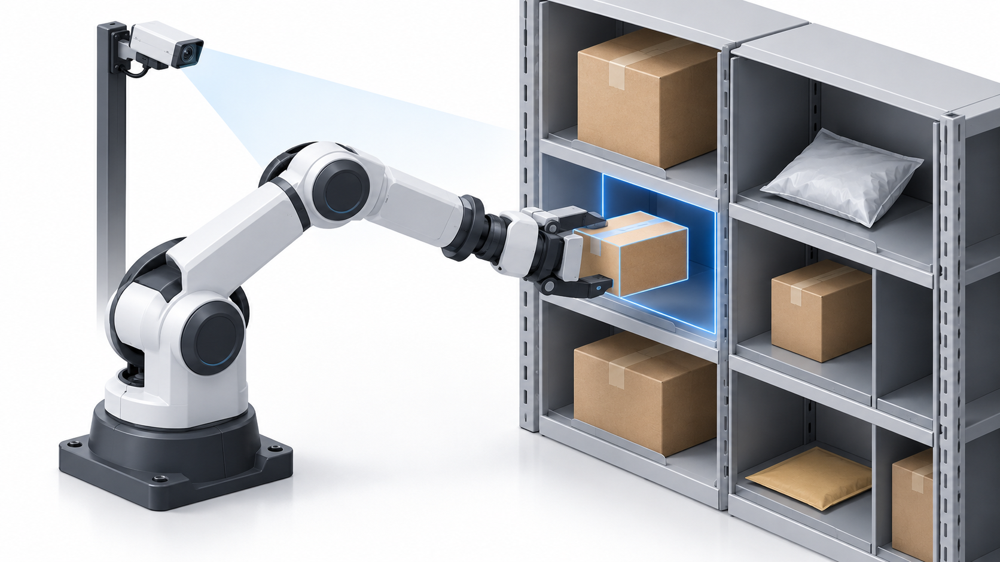

# Object-Aware Robotic Warehouse Manipulation

Robotic shelf stowing and retrieval using pretrained VLAs, focusing on thin, deformable, and partially occluded objects.

## Planned Stack
- Python and PyTorch for pretrained VLA inference
- OpenVLA / OpenVLA-OFT as candidate backbones
- Object segmentation and depth-based rack-clearance estimation
- Temporal tracking, ROI-based vision, and cached rack geometry

## Baseline & Evaluation
Compare against the same pretrained VLA using full-frame observations without explicit object/rack geometry conditioning.

Evaluate task success, collisions, drops, and observation-to-action latency. Ablations examine geometry conditioning, temporal memory, and ROI processing.

## References
- [OpenVLA](https://arxiv.org/abs/2406.09246)
- [OpenVLA-OFT](https://arxiv.org/abs/2502.19645)
- [SimToolReal](https://arxiv.org/abs/2602.16863) — reference for object-centric perception and control

**Status:** In development.
